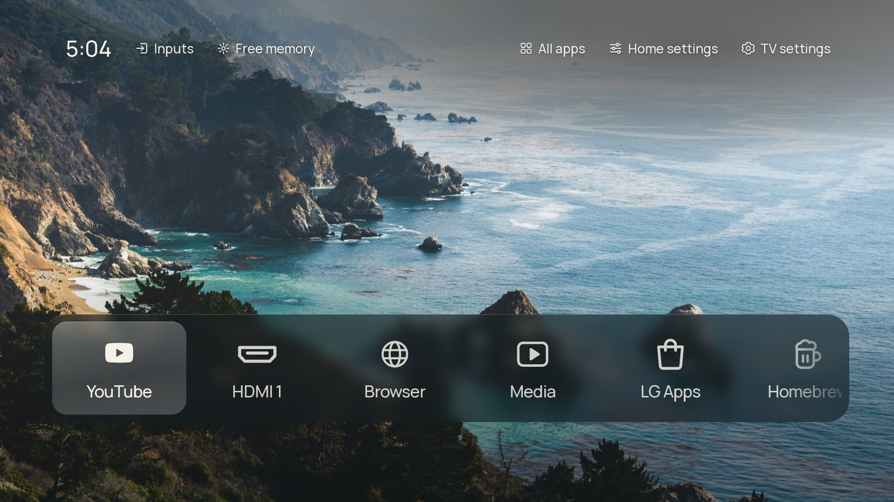
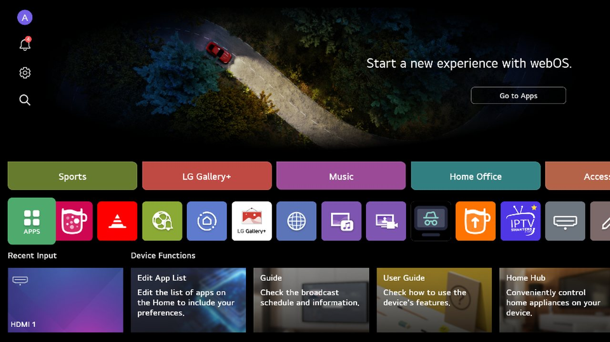
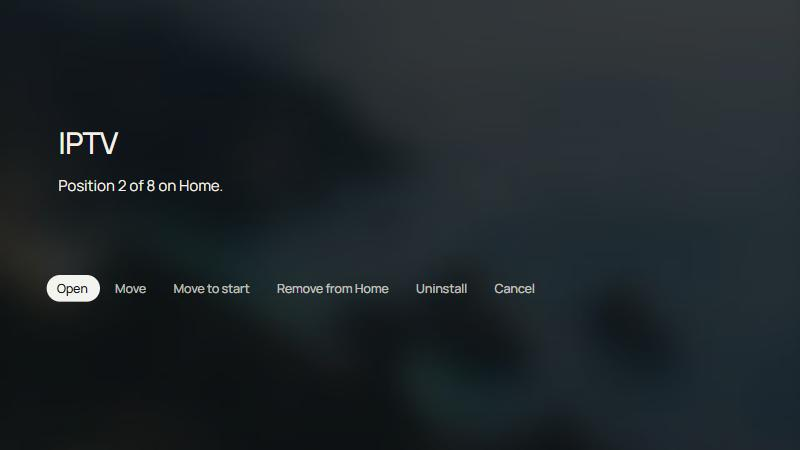
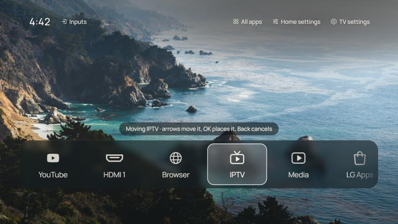
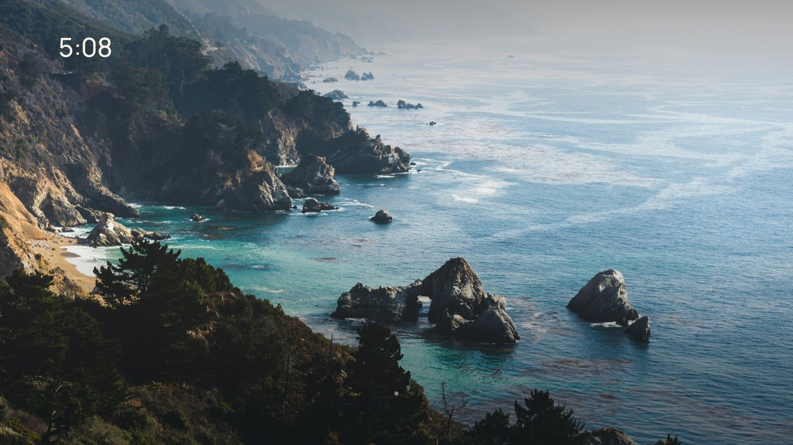
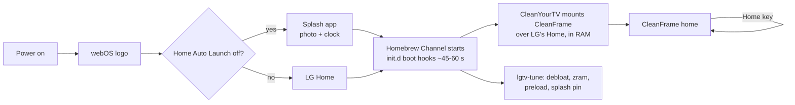

<div align="center">

# LG webOS Clean Home

**A calm, ad-free home screen for rooted LG webOS TVs, plus a faster TV.**
CleanFrame's photo and glass-dock home screen, ported from Samsung to LG, on top of a reversible debloat and memory tune-up.

-a50034?style=flat-square)




</div>

---

## Before and after

| LG's own Home | This project |
|---|---|
|  |  |
| Banners, "suggestions", sports, shopping and LG Gallery+ tiles, and tracking services running in the background. | One photograph, the time, your apps. No ads or recommendations, and nothing extra running. |

## What you get

- **A real CleanFrame home screen.** This is [CleanFrame](https://github.com/nthnclrk/CleanFrame)'s own code (layout, glass dock, photos, settings), with only its Samsung parts rewritten for LG. The dock slides left and right, there's no grid underneath, and it opens every time you press **Home**.
- **Top controls:**
  - left: **Inputs** (HDMI) and **Free memory** (closes everything running in the background and shows how much RAM you got back)
  - right: **All apps**, **Home settings** (this screen's own look options) and **TV settings** (LG's settings)
- **Hold OK on any app** for a menu: Open · Move · Move to start · Remove from Home / Add to Home · Uninstall · Cancel.
- **No LG Home at boot.** A splash with the same photo and clock covers the first minute of a cold start, then the dock appears. With Quick Start+, power on resumes straight into it.
- **A faster TV:**
  - LG's log uploads and recommendation services are stopped.
  - LG no longer keeps apps preloaded in the background.
  - 384 MB of compressed RAM (zram) is added, so apps get pushed out to slow flash less often.
  - The flash storage is trimmed once a week.
- **Install any webOS app** (`.ipk`) from your PC in one command, or from the Homebrew Channel.
- **Everything is reversible.** Nothing on LG's read-only system partition is touched; changes live in RAM and are re-applied by a boot hook.

| Hold OK on an app | Move an app along the dock |
|---|---|
|  |  |

## Tested on

| TV | Firmware | Root |
|---|---|---|
| LG 43UR7500PSC (UR75, 2023, 1.2 GB RAM) | webOS 25 / TV Lite 10.3.1 (33.31.61) | Homebrew Channel 0.7.3 |

Other webOS 23–25 TVs should work, since the parts that differ between models are detected at run time, but test carefully on yours.

> [!WARNING]
> This is for **rooted** TVs and you use it at your own risk. Keep the Homebrew Channel's firmware-update block on: an LG update can remove root. Never write to system partitions (kernel, rootfs, tvservice); this project never does.

---

## Install guide

You need a Windows PC on the same network as the TV, with OpenSSH (built into Windows 10/11), Git and Python 3.

<details open>
<summary><b>1. Root the TV and turn on SSH</b></summary>

1. Root it with [RootMyTV](https://rootmy.tv) or the method for your firmware. The Homebrew Channel gets installed.
2. On the TV, open **Homebrew Channel** → ⚙ **Settings** → turn **SSH Server** on. Leave **Block system updates** on.
3. Find the TV's IP address under Settings → General → Network. It's a good idea to reserve it in your router.

</details>

<details open>
<summary><b>2. Give your PC an SSH key for the TV</b></summary>

In PowerShell:

```powershell
ssh-keygen -t ed25519 -N '""' -f $env:USERPROFILE\.ssh\lgtv_root
type $env:USERPROFILE\.ssh\lgtv_root.pub | ssh root@<TV-IP> "mkdir -p ~/.ssh && cat >> ~/.ssh/authorized_keys"
```

The password it asks for is the Homebrew Channel default, `alpine`, unless you changed it. Nothing appears on screen while you type it. Once the key is in, the password is no longer used.

</details>

<details open>
<summary><b>3. Get this project and tell it your TV's address</b></summary>

```powershell
git clone https://github.com/Anexeus/lg-webos-clean-home
cd lg-webos-clean-home
$env:LGTV_IP = '<TV-IP>'      # or pass -TV <TV-IP> to every command
```

If PowerShell refuses to run scripts: `Set-ExecutionPolicy -Scope CurrentUser RemoteSigned`.

</details>

<details open>
<summary><b>4. Speed and privacy tweaks</b></summary>

```powershell
.\lgtv.ps1 deploy      # copies the scripts and the boot hook to the TV
.\lgtv.ps1 apply       # applies them now (they re-apply by themselves ~1 minute after every boot)
.\lgtv.ps1 status
```

What gets stopped or changed is listed in [What the tweaks do](#what-the-tweaks-do), and you can adjust it in `tv/lgtv-tune.conf`. For blocking LG's ad and tracking servers, also install **Life's Good Without Spying** from the Homebrew Channel.

</details>

<details open>
<summary><b>5. Install CleanYourTV for webOS (the plumbing)</b></summary>

[CleanYourTV for LG webOS](https://github.com/lasharor/cleanyourtv-WebOS) provides the small service and the boot scripts that make a web page the TV's Home. Its own debloat and Input-key features stay off, because step 4 already covers that.

```powershell
ssh -i $env:USERPROFILE\.ssh\lgtv_root root@$env:LGTV_IP "curl -fsSL https://raw.githubusercontent.com/lasharor/cleanyourtv-WebOS/main/install.sh | sh"
ssh -i $env:USERPROFILE\.ssh\lgtv_root root@$env:LGTV_IP "sh /media/developer/apps/usr/palm/services/com.cleanyourtv.manager.service/bootstrap.sh install --no-debloat --no-input-key"
```

The screen blinks once. If the new Home doesn't come up, it puts LG's Home back by itself.

</details>

<details open>
<summary><b>6. Make CleanFrame the home screen</b></summary>

```powershell
.\lgtv.ps1 cleanframe
```

This backs up CleanYourTV's own page, puts CleanFrame in its place and reloads Home. If a CleanYourTV update ever replaces the page, the boot hook puts CleanFrame back.

</details>

<details open>
<summary><b>7. Never see LG's Home at boot</b></summary>

```powershell
.\lgtv.ps1 splash
```

Then on the TV: **Settings → General → System → Additional Settings → Home Settings → Home Auto Launch: Off**.

</details>



---

## Using it

| Remote | What it does |
|---|---|
| **Left / Right** | Move along the dock |
| **OK** | Open the app |
| **Hold OK** | App menu: Open, Move, Move to start, Remove from / Add to Home, Uninstall (asks first) |
| **Up** | Top controls: Inputs · Free memory · All apps · Home settings · TV settings |
| **Back** (on Home) | Offers the LG Content Store |
| **Home** | Always brings this screen back, also from HDMI or any app |

### Installing apps

- **From the Homebrew Channel** on the TV: YouTube AdFree, Kodi, Jellyfin, Moonlight, RetroArch and more.
- **Any `.ipk` from your PC:**

  ```powershell
  .\lgtv.ps1 install-ipk C:\path\to\app.ipk
  .\lgtv.ps1 apps                  # what can be uninstalled
  .\lgtv.ps1 uninstall-app <id>
  ```

LG TVs can't run Android apps (`.apk`), so apps like Brave, which only exist for Android, can't be installed.

## What the tweaks do

| Area | Change | Why |
|---|---|---|
| Telemetry | Stops `remotelogger` and `service-logger` | They collect logs and upload them to LG |
| Suggestions | Stops `contentminer` | It builds the recommendation rows |
| Preloading | Switches off LG's background preload of the browser, voice search and guide | On 1.2 GB of RAM, preloads push your own apps out of memory |
| Memory | 384 MB zram (lz4), used before the flash swap | Idle pages are compressed in RAM instead of written to slow flash |
| Storage | Weekly `fstrim` of the data partitions | LG never trims, so the flash slows down over time |
| Boot | Splash app pinned as bootd's "last app" | A cold boot shows the splash instead of LG's Home |

## How it works



- **CleanFrame** (`look/cleanframe-lg/`) is CleanFrame's web app. `device.js` is rewritten to call the CleanYourTV service on the TV (`127.0.0.1:8765`) for the app list, launching, uninstalling, HDMI inputs and closing apps. `main.js` is ported by scripts that are re-runnable on a fresh copy of CleanFrame.
- **CleanYourTV** bind-mounts the page over LG's Home at boot, so the Home key, HDMI exits and "back to Home" all land on it.
- **lgtv-tune** (`tv/`) is a boot hook in `/var/lib/webosbrew/init.d`. All of its changes are in RAM.

## Undo

| To remove | Command |
|---|---|
| The boot splash | `.\lgtv.ps1 splash-off`, then turn Home Auto Launch back on |
| CleanFrame (back to CleanYourTV's page) | `.\lgtv.ps1 cleanframe-undo` |
| LG's own Home | Open the CleanYourTV app → switch off "CleanYourTV as Home" |
| All tweaks and scripts | `.\lgtv.ps1 remove`, then restart the TV |

## FAQ

<details>
<summary><b>Will the new home always come back after HDMI, standby or a restart?</b></summary>

- **Home key, leaving an app, leaving HDMI:** yes, always. LG's Home *is* this page now.
- **Standby (Quick Start+ on):** the TV resumes where you left it, so you're back on this home screen within seconds.
- **Full restart or power cut:** the webOS logo, then the splash (with Home Auto Launch off), then the dock appears once the Homebrew Channel has started, about a minute in. The LG logo itself can't be removed; it's drawn before anything rootable runs.

</details>

<details>
<summary><b>Why does a cold boot take about a minute to show the dock?</b></summary>

The Homebrew Channel, which runs all root scripts, is started by webOS about 45 seconds after power on, and the switch to the new Home needs root. The splash covers that time. Keep Quick Start+ on and you'll rarely see a cold boot at all.

</details>

<details>
<summary><b><code>luna-send</code> prints nothing over SSH</b></summary>

On this firmware it only prints to a terminal. The scripts wrap it in `script -q -c "luna-send …" /dev/null`.

</details>

## Project layout

```
lgtv.ps1                  PC control script (deploy, apply, cleanframe, splash, install-ipk, ...)
tv/                       everything that runs on the TV
  lgtv-tune.conf          settings for the tweaks
  tune.sh / undo.sh       apply / revert the tweaks
  bootsplash.sh           cold boot -> splash -> CleanFrame
  cleanframe.sh           install CleanFrame as the Home page (with backup and self-repair)
  ipk.sh                  install / remove apps through LG's installer
  90-lgtv-tune            the boot hook
look/
  cleanframe-lg/          CleanFrame, ported to LG (the home screen)
  port_cleanframe.py      Samsung -> LG port of main.js
  cleanframe_features*.py Inputs, Free memory, Home/TV settings, hold-OK menu
  make_cleanframe_marks.py  white app symbols in CleanFrame's style
  splash/  build_ipk.py   the boot splash app and the .ipk builder
  theme/ icons*/ ...      an alternative look for CleanYourTV's own launcher
docs/images/              screenshots
```

## Credits and licences

- **[CleanFrame](https://github.com/nthnclrk/CleanFrame)** by Nathan Clark: the home screen (MIT, `look/cleanframe-lg/LICENSE-CleanFrame.txt`). Its photographs are under the Unsplash License and its fonts (Manrope, Geist, Newsreader) under the SIL OFL; see `look/cleanframe-lg/THIRD_PARTY_NOTICES.md`.
- **[CleanYourTV for LG webOS](https://github.com/lasharor/cleanyourtv-WebOS)** by lasharor: the Home takeover service. It isn't included here; you install it in step 5. It was also the reference for the debloat, zram and trim ideas.
- **[Homebrew Channel / webOS Homebrew](https://www.webosbrew.org)** and **[RootMyTV](https://rootmy.tv)**.
- Brand marks (YouTube and others) belong to their owners. This project isn't affiliated with LG, Samsung or any streaming service.

Everything else in this repository is under the [MIT License](LICENSE).
